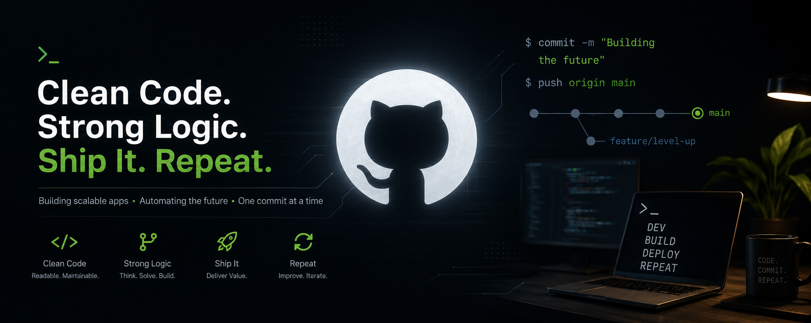

<div align="center">

<a href="https://www.linkedin.com/in/musa-leshkov/">
  
</a>

[](https://readme-typing-svg.demolab.com)

[](https://github.com/musaleshkov)
[](https://www.linkedin.com/in/musa-leshkov/)
[](mailto:musaleshkov@gmail.com)
 
</div>

## `> whoami`

I’m Musa, a  **Passionate Engineer who loves building** who loves building and solving problems.
From concept to code, every project becomes a refined digital experience — bold in vision, smooth in motion, and built with purpose.

[Explore my portfolio](https://musa-code.com/)

```ts
const musa = {
  roles: ["Senior Full-Stack Engineer", "Software Architect", "Principal Engineer"],
  building: ["Enterprise Platforms", "Real-Time Systems", "AI-Powered Tools"],
  caresAbout: ["Clean Architecture", "Fast Interfaces", "Developer Experience"],
  location: "Mars - SpaceX station",
  motto: "Make complex systems feel simple."
};
```

### 🛠️ Technology radar

<div align="center">

### Frontend architecture

[](https://skillicons.dev)

### Backend, data and AI

[](https://skillicons.dev)

### Cloud, delivery and quality

[](https://skillicons.dev)

</div>

---

### 💡 What I build

- **Enterprise platforms** - Multi-brand web platforms, shared design systems, and microfrontends that teams can ship independently.
- **Real-time systems** - Event-driven backends for vehicle telemetry, paired with dashboards that make live data easy to act on.
- **AI-powered tools** - Semantic search, contract summarization, and on-device anomaly detection.
- **Technical leadership** - Setting architecture direction, mentoring engineers, and making releases more reliable through shared engineering standards.

---


### Let's build something that matters
<div align="center">

Open to conversations about **software architecture**, **AI products**, **technical leadership**, and ambitious engineering challenges.

[](https://www.linkedin.com/in/musa-leshkov/)

<sub>Built with curiosity and an unreasonable appreciation for clean architecture.</sub>


</div>
